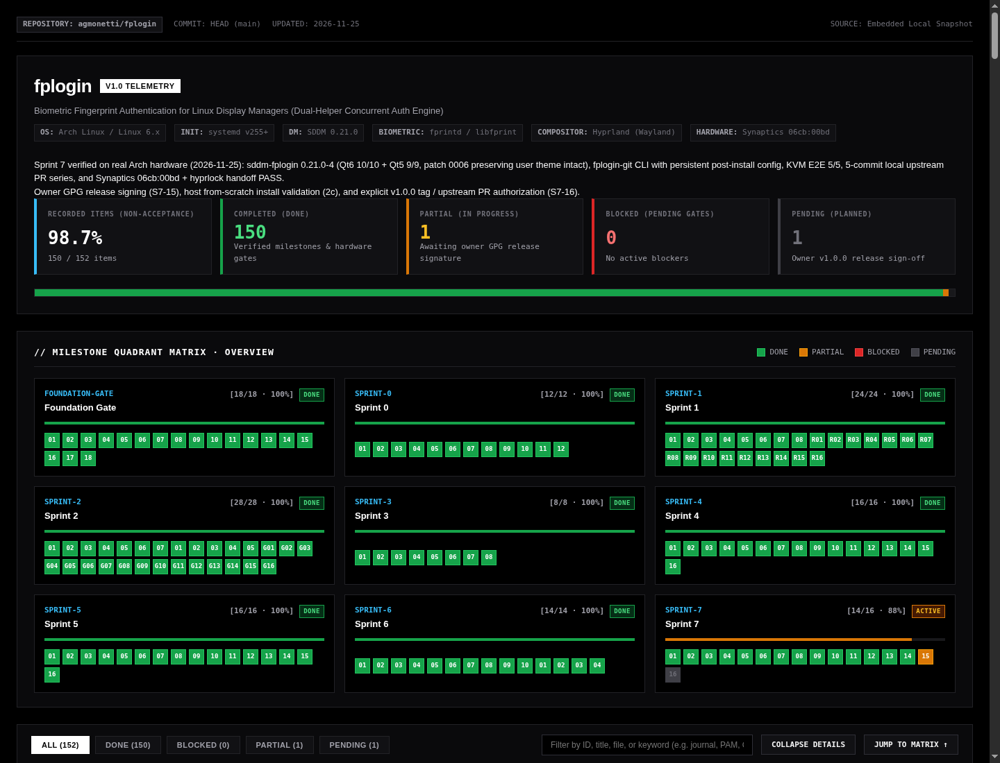

# fplogin

Biometric login for Linux, under active development. The v1 target is fingerprint login from SDDM with no Enter key, no in-place edits to existing system configuration, and no password storage.

[](dashboard.html)

The dashboard reflects the [Sprint 7 local/private verification](docs/reviews/sprint-7.md) completed on 2026-11-25 (`sddm-fplogin 0.21.0-4` dual Qt6 10/10 + Qt5 9/9 with `0006-legacy-theme-auto-fingerprint.patch` preserving the user's existing theme intact, `fplogin-git` transactional installer/analyzer/config CLI, 5/5 clean Arch KVM E2E lifecycle, real Arch hardware cold-boot + `where_is_my_sddm_theme` + `hyprlock` handoff on Synaptics `06cb:00bd`, 5-commit local upstream SDDM PR series, and local checksummed v1.0.0 release artifacts).

## The problem

SDDM does not natively support fingerprint authentication. Users must type their password or, with manual PAM tweaks, press Enter and then place their finger. There is no built-in experience where the reader activates automatically and works in parallel with the password field.

## Approach

`fplogin` delivers:

- A minimal, upstream-quality SDDM patch series coordinating concurrent PAM authentication methods (`password` + `fingerprint`) with single-winner arbitration and full hardening.
- A dedicated PAM service for biometric authentication (`sddm-fingerprint`) leaving `/etc/pam.d/sddm` untouched.
- Non-intrusive auto-fingerprint support for existing Qt5 and Qt6 SDDM themes (`[General] AutoFingerprintForLegacyThemes=true`), plus an optional built-in `fplogin` theme.
- A transactional Go installer, uninstaller, recovery engine, persistent post-install configurator (`fplogin config`), and read-only system difference analyzer (`fplogin analyze`).

**Theme compatibility:** `sddm-fplogin` (`0006-legacy-theme-auto-fingerprint.patch`, shared by Qt6 and Qt5 greeters) automatically starts one bounded concurrent fingerprint attempt for existing Qt5/Qt6 themes that do not call the fingerprint API (`[General] AutoFingerprintForLegacyThemes=true`), leaving the user's configured theme 100% visually intact (verified on real hardware with untouched `where_is_my_sddm_theme`), while themes that explicitly use the [theme-context contract](docs/architecture/SDDM_THEME_CONTEXT_CONTRACT.md) (such as the optional `/usr/share/sddm/themes/fplogin` theme) retain full API control and the emergency embedded fallback stays strictly password-only.

The SDDM daemon—not the greeter theme or fplogin adapter—coordinates login-time authentication. For one daemon-bound user/session request, it runs separate password and fingerprint helpers. The first successful method wins; the daemon cancels and observes the losing helper before authorizing exactly one PAM transaction to establish credentials, open the session, and start it. The fplogin adapter is an install-time component only.

## Planned v1 scope

| Will | Will not |
|---|---|
| Fingerprint login from SDDM | Store, inject, or recover the user's password |
| Activate the reader automatically when the greeter appears | Unlock wallets (KWallet, GNOME Keyring) via fingerprint |
| Keep password as a simultaneous fallback | Modify existing system PAM files in place |
| Cancel the unused method upon authentication | Replace subsequent authentications (sudo, polkit, su) |
| Install and configure SDDM if not present | Enroll fingerprints (uses those already registered in fprintd) |
| Detect and migrate from another display manager | Integrate with TPM or other cryptographic hardware |
| Uninstall cleanly restoring previous state | Work without fprintd or without an enrolled fingerprint |
| Analyze the system and report operational differences | Support distros outside Arch Linux (v1) |

## Architecture

```text
fplogin/
├── cmd/                         # Core, adapter, and platform executables
├── internal/
│   ├── core/                    # DM-independent selection/install/analyzer logic
│   ├── protocol/                # Versioned Go wire and manifest types
│   ├── adapterclient/           # Bounded adapter process client
│   └── platformclient/          # Bounded platform process client
├── contracts/                   # Versioned JSON schemas and examples
├── platforms/
│   └── arch/                    # Arch package/service provider
├── adapters/
│   └── sddm/
│       ├── patches/             # Pinned SDDM patch series
│       ├── assets/
│       │   ├── pam/             # Dedicated fingerprint PAM service
│       │   └── theme/           # SDDM greeter theme
│       └── packaging/
│           └── arch/            # Arch package recipe
├── tests/                       # Contract, integration, fixture, and VM checks
└── docs/                        # Architecture, plans, hardware, and sprint reviews
```

### Core-adapter contract

`internal/core/` must remain completely agnostic to any display manager. It defines interfaces, state machines, manifest generation, and analysis logic, but never imports, references, or branches on specific display managers:

- **Core defines interfaces:** DM detection and versioning, prerequisite validation, asset install/uninstall, DM state inspection, and authentication capability negotiation.
- **Adapters implement those interfaces:** the planned `adapters/sddm/` executable will implement the contract for SDDM v1. Future adapters (for example LightDM or greetd) implement the same interfaces without changing core logic.
- **Discovery over hardcoding:** The core resolves adapters through capability/support declarations, never through conditional logic like `if dm == "sddm"`.

### Planned installation paths

| Repository path | System destination |
|---|---|
| `adapters/sddm/assets/pam/sddm-fingerprint` | `/etc/pam.d/sddm-fingerprint` |
| `adapters/sddm/assets/theme/*` | `/usr/share/sddm/themes/fplogin/` |
| `adapters/sddm/assets/config/sddm.conf.d/fplogin.conf` | `/etc/sddm.conf.d/fplogin.conf` |

No existing system files will be modified in place. The installer will generate a manifest at `/var/lib/fplogin/manifest.json` containing installed assets, checksums, and previous system state for clean rollback during uninstallation.

## Planned v1 requirements

| Requirement | Required | Notes |
|---|---|---|
| Arch Linux | Yes | Only supported distro in v1 |
| systemd | Yes | DM service management |
| fprintd | Yes | Installer will add it when missing |
| libfprint | Yes | fprintd dependency |
| Compatible fingerprint reader | Yes | Verified during installation |
| Enrolled fingerprint | Yes | Required before login verification; enrollment is outside the greeter |
| SDDM | Yes | Patched package will be installed and configured through the selected adapter/platform provider |
| qt6-declarative | Yes | Required for SDDM QML themes |

## CLI Usage

The pinned Arch tools package (`fplogin-git`) exposes read-only unprivileged inspection (`components`, `install --dry-run`, `status`, `analyze`, `config show`), persistent post-install configuration (`sudo fplogin config set`), and transactional offline installation/removal/recovery verified on Arch x86_64 with real systemd PID 1. Live `install`, `uninstall`, and `recover` require root privileges, a root-owned offline trust root (`/etc/fplogin/trust`), and explicit approval bound to the core-computed `ChangePlan` SHA-256 (plus separate `--approve-replace-dm` confirmation before replacing a conflicting display manager), followed by non-fatal read-only postflight analysis. See the [Sprint 7 release validation review](docs/reviews/sprint-7.md).

```bash
# Unprivileged read-only commands
fplogin components                                              # list packaged providers and adapters
fplogin install --dry-run [--target ADAPTER_ID/TARGET_ID]       # read-only preflight and preview
fplogin status                                                  # read manifest and verify file checksums
fplogin analyze [--json] [--root DIR] [--service NAME]          # read-only password-derived facility analyzer
fplogin config show                                             # inspect persistent SDDM fingerprint drop-in settings

# Root transactional & persistent configuration commands
sudo fplogin install --artifacts-dir DIR [--activate] [--approve-plan SHA256] [--approve-replace-dm]
sudo fplogin config set [--auto-legacy true|false] [--timeout 5..120] [--theme preserve|fplogin|<name>]
sudo fplogin uninstall [--modified-files preserve|refuse|restore] [--remove-shared-deps] [--yes]
sudo fplogin recover                                            # reconcile any interrupted transaction
```

To build the Arch tools package, run `make package` as an ordinary user in an isolated Arch environment with `base-devel`, Go, Git, and the recipe's runtime dependencies installed. It stages a pinned source archive and prints the package paths. Verify the main archive with `bash tests/integration/arch-tools-package.sh <package>` and the real-systemd KVM guest lifecycle with `bash tests/integration/s4-cli-e2e-run.sh <package>`. The SDDM theme and PAM service are shipped separately in `sddm-fplogin`.

## Documentation

- [Implementation Plan](docs/IMPLEMENTATION_PLAN.md): Roadmap, verification matrix, security model, and Definition of Done.
- [Emergency Recovery Guide](docs/EMERGENCY_RECOVERY.md): Step-by-step procedures for interrupted transactions, journal recovery, and PAM restore.
- [Supported Versions & Policy](docs/SUPPORTED_VERSIONS.md): Supported Linux distributions, desktop environments, PAM, and toolchain dependencies.
- [Upstream SDDM Tracking](docs/UPSTREAM_TRACKING.md): Patch rebase policy, conflict handling, and upstream PR tracking.
- [Core Language and Adapter Contract](docs/architecture/CORE_ADAPTER_ANALYSIS.md): Language evaluation, adapter protocol, repository foundation, and architectural risks.
- [SDDM Concurrent Authentication Design](docs/architecture/SDDM_AUTHENTICATION_DESIGN.md): Pinned baseline, stock message flow, winner gate, cancellation boundary, and proposed SDDM IPC.
- [SDDM Greeter and Theme Design](docs/architecture/SDDM_GREETER_DESIGN.md): Context correlation, typed reader states, controlling-view lifecycle, and password fallback.
- [Threat Model & Security Boundaries](docs/security/THREAT_MODEL.md): Consolidated five-boundary threat model mapped to §3.2 security invariants.
- [Synaptics Test Hardware](docs/hardware/SYNAPTICS_06CB_00BD.md): Primary physical-reader record and scenario matrix.
- [Sprint 7 Validation Review](docs/reviews/sprint-7.md): End-to-end KVM, dual Qt6/Qt5, upstream PR series, and real-hardware verification record.

## License

MIT

