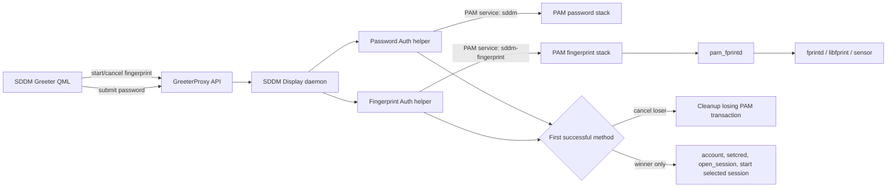

# fplogin Implementation Plan

## 1. Executive decision

fplogin will be a standalone project that packages, installs, diagnoses, and removes biometric login support. Its SDDM integration will require a small, reviewable SDDM source patch.

A theme-only implementation is not sufficient. The public SDDM greeter API exposes `login(user, password, sessionIndex)` but does not expose a way to start a second PAM service or report an independently verified fingerprint as an authenticated login. A QML theme also must not become an authentication authority.

The project therefore has two layers:

1. **Display-manager-independent core:** system analysis, installation state, manifests, rollback, and shared policy definitions.
2. **SDDM adapter:** an upstream-quality patch that adds concurrent password and fingerprint PAM transactions, plus the SDDM greeter UI and Arch package integration.

Development will happen against an SDDM fork branch so the code can be reviewed and tested. Once stable, the SDDM changes will be submitted upstream as a focused pull request. fplogin remains useful even if the pull request is not merged because it can package the maintained patch against a supported SDDM release.

> [!IMPORTANT]
> The initial exploration evaluated a theme-only approach, but research proved that authentication orchestration must remain in SDDM/PAM; the theme only requests methods and displays state.

## 2. Product goal

Provide an Arch Linux user with an SDDM login screen where:

- Fingerprint verification starts automatically for the selected user.
- Password login remains available at the same time.
- The first successful authentication method starts exactly one user session.
- The losing authentication transaction is cancelled and cleaned up.
- Account and session policy remain equivalent to normal SDDM login.
- No password is stored, generated, recovered, or injected.
- Installation and removal are transactional and auditable.
- The user receives an evidence-based report about password-derived facilities that may remain locked after fingerprint login.

## 3. Architecture



### 3.1 Trust boundaries

- **QML theme:** presentation and user intent only. It never validates fingerprints and never receives privileged credentials.
- **SDDM daemon:** owns method coordination, request identity, user/session binding, and winner selection.
- **sddm-helper:** owns one PAM transaction and reports typed progress/result events.
- **PAM:** remains the authentication and account-policy authority.
- **fprintd:** owns sensor access and fingerprint matching through `pam_fprintd`.
- **Installer:** runs privileged only for package and system configuration changes.
- **Analyzer:** read-only; it must not unlock wallets, read secrets, or alter PAM.

### 3.2 Authentication invariants

1. A fingerprint result is bound to the selected username and the current request ID.
2. Changing user or session invalidates and cancels the active fingerprint request.
3. At most one authentication transaction may cross into session creation.
4. The losing transaction must call `pam_end` or be terminated with bounded cleanup.
5. A fingerprint failure must not disable password login.
6. Password login must continue to use the distribution-provided `sddm` PAM service.
7. Fingerprint login must use a dedicated `sddm-fingerprint` service.
8. Fingerprint configuration must not modify global services such as `system-auth`, `sudo`, `su`, or polkit.
9. No password or reusable secret is persisted by fplogin.
10. If biometric prerequisites fail, the system must remain usable through normal SDDM password login.

## 4. Repository model

```text
fplogin/
├── docs/
│   ├── IMPLEMENTATION_PLAN.md
│   ├── architecture/
│   └── reviews/
├── core/
│   ├── analyze/
│   ├── install/
│   ├── manifest/
│   └── platform/
│       └── arch/
├── adapters/
│   └── sddm/
│       ├── patches/
│       ├── pam/
│       │   └── sddm-fingerprint
│       ├── theme/
│       └── packaging/
│           └── arch/
├── tests/
│   ├── fixtures/
│   ├── integration/
│   └── vm/
├── install.sh
├── uninstall.sh
├── LICENSE
└── README.md
```

The repository will not vendor a permanent copy of SDDM. The SDDM changes live as commits in the development fork and as a reproducible patch series pinned to a supported upstream tag in fplogin.

## 5. Supported platform for v1

| Requirement | v1 policy |
|---|---|
| Distribution | Arch Linux |
| Init/service manager | systemd |
| Display manager | SDDM 0.21-compatible baseline, exact version pinned during Sprint 0 |
| Greeter runtime | Qt/QML version provided by the selected SDDM package |
| Fingerprint stack | fprintd + libfprint + `pam_fprintd.so` |
| Sensor | Any reader successfully supported by the installed libfprint stack |
| Session | Hyprland is the primary verified session; other SDDM sessions are not blocked but are not certified in v1 |
| Accounts | Local users supported by the distribution PAM stack |
| Packaging | Arch PKGBUILD/package workflow |
| Hardware security | No TPM requirement |

## 6. Included and excluded behavior

| Included in v1 | Explicitly excluded from v1 |
|---|---|
| Automatic fingerprint attempt for selected user | Password storage, escrow, recovery, or injection |
| Simultaneous usable password fallback | Automatic KWallet or GNOME Keyring unlock after fingerprint login |
| Dedicated fingerprint PAM service | Global fingerprint enablement in `system-auth` |
| Account/session policy equivalent to normal login | Changes to sudo, su, SSH, or polkit authentication |
| Reader detection and enrolled-print preflight | Fingerprint enrollment inside the greeter |
| SDDM installation and optional DM migration | Automatic replacement of another DM without explicit approval |
| Transactional install and uninstall | Editing user-owned themes or PAM files in place |
| Manifest and backup metadata | Storing secret contents in the manifest |
| Evidence-based system analysis | Claiming to discover every application that may request a secret |
| Hyprland end-to-end verification | Full support certification for Plasma, GNOME, LightDM, or greetd |
| Upstream SDDM pull request | Depending on upstream merge for fplogin releases |

## 7. System analyzer contract

The analyzer answers a narrow question: **which installed and configured password-derived facilities are likely to behave differently after fingerprint login?**

It will inspect:

- Active display manager and SDDM package/version.
- fprintd service, devices, enrolled fingers, and PAM module presence.
- Relevant PAM service files and their effective includes.
- `pam_kwallet5.so`, `pam_gnome_keyring.so`, `pam_mount.so`, and `pam_systemd_home.so` presence and configuration.
- Installed KWallet, GNOME Keyring, Secret Service providers, and known user configuration where safely readable.
- LUKS/crypttab and systemd-homed configuration without reading secrets.
- Known session startup integration required by KWallet or GNOME Keyring under a window manager.

Each finding will contain:

- Component.
- Evidence path or command result.
- Fingerprint-login impact.
- Password-login comparison.
- Confidence: `confirmed`, `likely`, or `unknown`.
- Suggested user action, if any.

The analyzer will not:

- Scan arbitrary process memory.
- Read wallet contents or passwords.
- Guess behavior solely from package presence.
- Modify PAM or application settings.
- Promise complete discovery of all applications using a secret service.

## 8. Installer and rollback contract

### 8.1 Installer phases

1. Detect distribution, architecture, effective invoking user, and systemd.
2. Detect SDDM and any enabled display-manager unit.
3. Detect fprintd, PAM module, reader, and enrolled fingerprint.
4. Produce a complete proposed change set before mutation.
5. Ask for explicit approval when packages are installed or another DM is replaced.
6. Build or install the pinned fplogin SDDM package.
7. Install the dedicated PAM service and theme/configuration assets.
8. Validate files, permissions, package ownership, and PAM service syntax.
9. Write the installation manifest atomically.
10. Enable SDDM only after all prior checks succeed.
11. Run the analyzer and print the behavioral-difference report.

### 8.2 Manifest

`/var/lib/fplogin/manifest.json` records only operational metadata:

- fplogin version.
- Installed package versions.
- Files created by fplogin and their checksums.
- Previous enabled display manager.
- Previous SDDM theme/configuration state.
- Services enabled or disabled by the installer.
- Installation timestamp and platform information.

It must never contain passwords, PAM responses, fingerprint templates, wallet contents, or other secrets.

### 8.3 Uninstaller

The uninstaller will:

1. Verify the manifest and installed-file checksums.
2. Refuse to delete files that no longer match fplogin-installed content without explicit user action.
3. Restore the previous DM/theme state when recorded and still available.
4. Remove only fplogin-owned files and package artifacts.
5. Leave fprintd, SDDM, and shared dependencies installed by default; optional package removal may be offered only when fplogin originally installed them and no dependent package requires them.
6. Preserve a recovery path if service restoration fails.

## 9. Sprint model

Every sprint is a complete cycle:

1. **Plan:** confirm scope, affected trust boundaries, acceptance criteria, and rollback.
2. **Implement:** deliver only that sprint's vertical slice.
3. **Verify:** run focused automated checks and an executable scenario.
4. **Security check:** review new privileged inputs, state transitions, and failure behavior.
5. **Sprint review:** demonstrate observable behavior, record evidence, decisions, risks, and backlog changes in `docs/reviews/sprint-N.md`.
6. **Gate:** proceed only when exit criteria pass; otherwise repeat the sprint with corrected scope.

A sprint review is not a progress summary. It must include commands/scenarios executed, observed results, unresolved defects, and an explicit `accepted`, `repeat`, or `stop` decision.

## 10. Sprint plan

### Sprint 0 — Feasibility, baseline, and architecture correction

**Goal:** prove the integration boundary before building product code.

**Work**

- Pin the target SDDM upstream tag and Arch package baseline.
- Build and run unmodified SDDM in an isolated VM/test environment.
- Map the current greeter → daemon → helper → PAM message flow.
- Confirm that theme-only QML cannot start a second PAM service through the public API.
- Prototype two independent `Auth`/helper transactions without starting a real session.
- Verify cancellation behavior while `pam_fprintd` is waiting.
- Define IPC messages for method start, progress, cancellation, and result.
- Correct README architecture and installation claims.
- Define the test hardware record for the available Synaptics reader.

**Acceptance**

- Stock SDDM build is reproducible.
- Two authentication helpers can be distinguished and independently stopped.
- The selected-user/request binding is documented.
- A failed or cancelled fingerprint attempt leaves password authentication usable.
- README matches the proven architecture.

**Sprint review**

- Demo: stock password login plus isolated fingerprint-helper start/cancel.
- Evidence: build command, logs, PAM transitions, and cancellation result.
- Gate: approve the SDDM patch boundary or stop the project before installer work.

### Sprint 1 — SDDM authentication-method core

**Goal:** add method-aware concurrent authentication without theme-specific behavior.

**Work**

- Add typed authentication methods: password and fingerprint.
- Extend daemon/helper IPC with request ID, method, selected user, and state.
- Add a dedicated helper launch using `sddm-fingerprint`.
- Coordinate two active auth transactions per display.
- Implement atomic first-success-wins selection.
- Cancel and clean up the losing PAM transaction.
- Ensure only the winner reaches account management, credentials, session open, and session launch.
- Preserve existing autologin, greeter, session reuse, and password-only behavior.

**Acceptance**

- Password-only behavior remains unchanged when fingerprint is disabled/unavailable.
- Fingerprint and password can be active concurrently.
- Exactly one session starts under simultaneous success conditions.
- User/session changes invalidate stale fingerprint results.
- Helpers and PAM handles are cleaned after success, failure, timeout, and display stop.

**Sprint review**

- Demo: concurrent attempts, password win, fingerprint win, user switch, reader timeout.
- Evidence: focused unit/integration results and process/PAM cleanup logs.
- Gate: no UI work until race and cleanup invariants pass.

### Sprint 2 — Greeter API and SDDM theme

**Goal:** expose safe method control and deliver the intended user experience.

**Work**

- Extend `GreeterProxy` with fingerprint availability, state, start, and cancel APIs.
- Keep fingerprint matching and authorization out of QML.
- Build the fplogin SDDM theme.
- Start fingerprint automatically only after a concrete user is selected.
- Keep password input immediately usable.
- Display reader states: unavailable, ready, scanning, retry, matched, failed, cancelled, timed out.
- Cancel on user change, session change where required, shutdown, or greeter destruction.
- Provide accessible keyboard navigation and password-only fallback.

**Acceptance**

- No Enter press is required to activate fingerprint verification.
- Typing/submitting a password remains possible while the reader waits.
- UI state always corresponds to the current request ID/user.
- No password or fingerprint template reaches logs or theme-readable state.
- Theme failure falls back to a usable embedded/password greeter path.

**Sprint review**

- Demo on actual SDDM surface: fingerprint win, password win, invalid finger, user switch, missing reader.
- Evidence: visual capture plus daemon/helper logs with secrets redacted.
- Gate: UX and fallback accepted before packaging.

### Sprint 3 — PAM service and Arch packaging

**Goal:** make the patched stack reproducibly installable.

**Work**

- Author a minimal Arch-compatible `sddm-fingerprint` PAM service.
- Reuse distribution account/session policy without invoking password authentication after fingerprint success.
- Define fingerprint retry and timeout policy.
- Create a PKGBUILD pinned to the supported SDDM source and fplogin patch checksum.
- Declare conflicts/provides/replaces behavior conservatively for the SDDM package.
- Package theme, PAM service, and license metadata with correct ownership and modes.
- Document recovery through TTY and package rollback.

**Acceptance**

- Package builds in a clean Arch build environment.
- Installed files are package-owned and reproducible.
- Password, account restrictions, session creation, and fingerprint paths work.
- Removing the package restores a stock-compatible SDDM package path.
- No global PAM service is changed.

**Sprint review**

- Demo: clean package build, install, login both ways, downgrade/rollback.
- Evidence: package metadata, installed paths/modes, PAM scenario results.
- Gate: package lifecycle accepted before automation wraps it.

### Sprint 4 — Transactional installer and uninstaller

**Goal:** support machines with or without SDDM safely.

**Work**

- Implement read-only preflight and proposed-change output.
- Detect installed and enabled display managers.
- Install prerequisites through pacman using explicit package lists.
- Require confirmation before replacing another enabled DM.
- Install the fplogin package and activate its theme through a dedicated drop-in.
- Write the manifest atomically only after successful installation.
- Implement rollback for every mutation stage.
- Implement idempotent reinstall/upgrade behavior.
- Implement checksum-aware uninstall and previous-DM restoration.

**Acceptance**

- Fresh Arch VM without SDDM reaches a configured but recoverable installation.
- Existing SDDM configuration is preserved.
- Existing alternative DM is never disabled without approval.
- Injected failure at every mutation point rolls back to a bootable login state.
- Re-running install or uninstall is safe and deterministic.

**Sprint review**

- Demo matrix: no DM, stock SDDM, alternative DM, partial prior install, interrupted install.
- Evidence: before/after service state, manifest, checksums, and rollback results.
- Gate: no release while any failure path can leave the machine without a login manager.

### Sprint 5 — System difference analyzer

**Goal:** report the practical difference between password and fingerprint login without overstating certainty.

**Work**

- Build structured probes for PAM, wallets, secret services, homed, crypttab/LUKS, and session startup.
- Separate system probes from report formatting.
- Produce terminal text and machine-readable JSON.
- Add confidence and evidence to every finding.
- Integrate analyzer output into installer postflight.
- Document known blind spots.

**Acceptance**

- Analyzer is read-only and works unprivileged where possible.
- Fixtures cover KWallet, GNOME Keyring, no wallet, LUKS reuse, homed, and unknown/custom PAM configurations.
- It never labels package presence alone as confirmed behavior.
- Output clearly distinguishes login-session effects from later independent authentication.

**Sprint review**

- Demo against fixture systems and the development machine.
- Evidence: JSON schema, finding provenance, false-positive/negative review.
- Gate: wording must be accurate enough for users to make an informed installation decision.

### Sprint 6 — Security and resilience hardening

**Goal:** validate authentication boundaries and hostile failure conditions.

**Work**

- Threat-model greeter IPC, helper lifecycle, D-Bus/fprintd availability, and package/install privilege boundaries.
- Test stale replies, replayed request IDs, user switching, rapid retries, simultaneous completion, process crashes, sensor removal, suspend/resume, and daemon restart.
- Verify no sensitive values appear in logs, manifests, environment, process arguments, or crash output.
- Validate file modes, ownership, symlink resistance, temporary-file handling, and atomic writes.
- Review CVE-relevant attention/intent UI and service-specific PAM scope.
- Conduct focused code review of privileged C++ and shell code.

**Acceptance**

- No identified path starts a session for a user other than the request-bound user.
- No double-session or post-cancel success is observable.
- Installer resists unsafe symlink/path replacement in privileged destinations.
- Reader/service failures preserve password fallback.
- All high-severity review findings are fixed or the release is blocked.

**Sprint review**

- Demo failure injection and selected adversarial scenarios.
- Evidence: threat model, review findings, fixes, and residual risks.
- Gate: explicit security acceptance required.

### Sprint 7 — End-to-end validation, release, and upstreaming

**Goal:** produce the first supportable release and upstream submission.

**Work**

- Run the complete cold-boot and lifecycle matrix on Arch + SDDM + Hyprland.
- Verify password login, fingerprint login, fallback, logout/login, reboot, suspend/resume, hyprlock handoff, uninstall, and recovery TTY.
- Finalize README, architecture, recovery, troubleshooting, and supported-version policy.
- Produce signed/checksummed release artifacts where project infrastructure permits.
- Convert the SDDM patch into focused commits with tests and submit the upstream PR.
- Document how fplogin tracks upstream SDDM releases and patch conflicts.

**Acceptance**

- A clean machine can install, log in both ways, uninstall, and return to its prior DM state.
- Actual hardware verification passes on the supported Synaptics reader.
- All release documentation matches observed behavior.
- The upstream PR is independently reviewable and does not include installer/analyzer concerns.

**Sprint review**

- Demo the full user journey from stock Arch state through uninstall.
- Evidence: release checklist, package checksums, test matrix, hardware record, and upstream PR link.
- Gate: tag v1.0 only after every critical path passes.

## 11. Verification matrix

| Scenario | Required result |
|---|---|
| No reader | Password login works; fingerprint UI reports unavailable |
| Reader, no enrollment | Password login works; no repeated fingerprint loop |
| Valid fingerprint | One correct user session starts |
| Invalid fingerprint | Retry/timeout is bounded; password remains usable |
| Password wins | Fingerprint helper is cancelled and releases the reader |
| Fingerprint wins | Password helper is cancelled; no password is synthesized |
| User changes mid-scan | Old request cannot authenticate new user |
| fprintd crashes | Password path survives |
| sddm-helper crashes | Failure is reported and fallback remains available |
| Suspend during scan | Scan is cancelled or safely restarted after resume |
| Logout and relogin | New request has fresh identity/state |
| Hyprlock after login | Reader can be claimed by hyprlock |
| Alternative DM installed | No replacement without explicit approval |
| Installation interrupted | Rollback leaves a usable display manager or documented TTY recovery |
| Uninstall after local edits | Modified files are preserved or require explicit handling |

## 12. Definition of done

v1 is done only when:

- The supported Arch/SDDM package is reproducible.
- Both authentication methods are concurrently usable without Enter.
- Exactly one session starts and all losing transactions are cleaned up.
- Password-only fallback survives every tested biometric failure.
- Installation, upgrade, interruption rollback, and uninstall are verified.
- The analyzer produces evidence-based findings with documented limitations.
- Actual SDDM UI and hardware behavior have been exercised.
- Security review has no unresolved high-severity finding.
- README, recovery instructions, architecture, and supported-version policy are complete.
- The SDDM change is prepared as an upstream-quality PR, whether or not upstream merges it.

## 13. Deferred roadmap

After v1 stabilizes:

- LightDM adapter.
- greetd adapter.
- Additional distributions and package backends.
- A display-manager adapter contract shared by installers/analyzers.
- Additional tested fingerprint hardware.
- Optional, separately threat-modeled wallet-unlock integrations if mature implementations emerge.
- Localization and broader accessibility review.

These items must not expand v1 scope or weaken its rollback and authentication guarantees.
