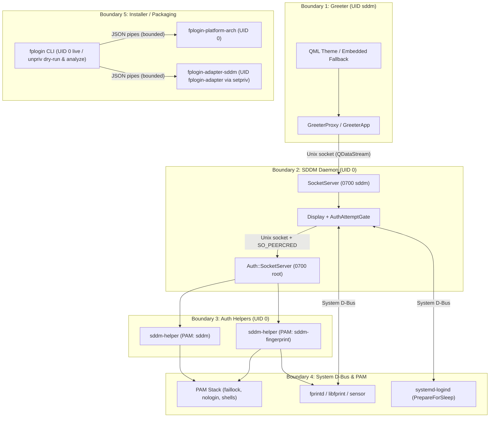

# fplogin Threat Model & Security Boundaries

- **Scope:** fplogin v1 (Arch Linux, SDDM `v0.21.0` + patch stack `0000..0005`, `fplogin` Go CLI, `fplogin-platform-arch`, `fplogin-adapter-sddm`, `sddm-fingerprint` PAM service, `fplogin` QML theme + embedded fallback).
- **Baseline:** [IMPLEMENTATION_PLAN.md](../IMPLEMENTATION_PLAN.md) (§3.1, §3.2, §10 Sprint 6), [SPRINT_6_EXECUTION_PLAN.md](../SPRINT_6_EXECUTION_PLAN.md), [sprint-1-security-review.md](../reviews/sprint-1-security-review.md).

## 1. Security Invariants (Non-Negotiable)

Every threat below is evaluated against the §3.2 authentication and installer invariants:

| ID | Invariant |
|---|---|
| **INV-1** | A fingerprint result is strictly bound to `(request_id, user, session, launch_generation)` of the active context. |
| **INV-2** | Changing user, changing session, disconnecting the greeter, or suspending invalidates and cancels any active fingerprint scan. |
| **INV-3** | At most one authentication transaction may cross `SESSION_AUTHORIZATION` into account/cred/session creation (atomic first-success-wins). |
| **INV-4** | The losing or cancelled helper must never receive `SESSION_AUTHORIZATION`, and must exit via bounded `SIGTERM` → `SIGKILL` cleanup. |
| **INV-5** | Any biometric, D-Bus, sensor, or theme failure preserves normal SDDM password login on the unmodified stock `sddm` PAM service. |
| **INV-6** | Fingerprint PAM policy lives exclusively in `/etc/pam.d/sddm-fingerprint` (`requisite` prechecks + `faillock preauth`, `password required pam_deny.so`); global PAM services (`system-auth`, `sudo`, `su`, `polkit`) are never altered. |
| **INV-7** | Zero secrets (passwords, PAM responses, X11 cookies, fingerprint templates, wallet contents) reach logs, manifests, WAL journals, analyzer reports, process argv/env, or QML-readable state. |
| **INV-8** | Privileged installer/uninstaller mutations are transactional, fsync-journaled before mutation, confined to root-owned paths, symlink/TOCTOU-resistant, and verify offline GPG + SHA-256 package signatures before applying. |

## 2. Trust Boundaries & Adversary Model

### Adversaries considered

1. **Local unprivileged user (`UID != 0`, `UID != sddm`):** Can see `/tmp` and world-readable files, inspect `/proc/<pid>/cmdline`, attempt to connect to local Unix sockets, race symlinks in writable directories, or drop crafted files in unprivileged paths.
2. **Compromised or buggy unprivileged greeter / QML theme (`UID sddm`):** Can send arbitrary, fragmented, oversized, replayed, or out-of-order IPC frames over the greeter socket, rapid-fire user/session changes, or attempt to trigger auth without valid context.
3. **Faulty, crashed, or race-delayed `sddm-helper` / `fprintd` / hardware reader:** Can send late `AUTHENTICATED` frames after cancel/timeout, crash mid-PAM (`SIGSEGV`/`SIGKILL`), vanish from D-Bus mid-scan, stall past deadlines, or unplug during verification.
4. **Physical bystander / casual attacker at the login screen:** Can touch the sensor during suspend/resume, attempt ghost-event or focus-hijack tricks, or try fingerprint login on a `faillock`-locked or `nologin` account.
5. **Tampered offline package / local filesystem race during root install/uninstall:** Can supply corrupted/unsigned archives, symlinked `.sig` or destination paths, tampered descriptors, or kill the installer (`SIGKILL`) mid-transaction.

*Out of scope for v1:* Kernel/root compromise, hardware/DMA attacks on USB sensor bus, malicious PAM modules installed by root, physical sensor spoofing (libfprint/sensor hardware domain), and automatic wallet unlock without password.

## 3. Threat Matrix

### Boundary 1 — Greeter ↔ SDDM Daemon IPC (`SocketServer.cpp`, `Display.cpp`, `GreeterProxy.cpp`)

| ID | Threat | Invariant | Current Mitigation | Sprint 6 Gap / Action |
|---|---|---|---|---|
| **T-IPC-01** | Malformed, truncated, negative-length, or oversized `QDataStream` frames crash or wedge the daemon event loop. | INV-5 | `QDataStream` transaction buffering, 1 MiB `inputLimit`, field-length caps (`user<=256`, `password<=65536`, `requestId<=64`, `sessionFile<=4096`), unknown opcode abort. | **S6-F02:** Adversarial fuzzing corpus against `SocketServer` + `GreeterProxy` (`S6-IPC-01`). |
| **T-IPC-02** | Greeter opens unbounded connections to `SocketServer` (FD exhaustion) or triggers null-socket dereference. | INV-5 | `QLocalServer::UserAccessOption` (`0700` owned by `sddm`). | **F-S6-04 / S6-F02:** `SocketServer::newConnection()` lacks null check, `hasPendingConnections()` loop, and max active connection cap (16). Fix + test. |
| **T-IPC-03** | Replayed `requestId` or stale `serial` authorizes wrong user/session or revives cancelled scan. | INV-1, INV-2 | Per-socket monotonic serials, UUID `requestId`, `AuthAttemptGate` tuple validation, cleared context barrier. | **S6-F02:** Explicit replay/stale-serial/user-switch adversarial tests (`S6-IPC-01`). |
| **T-IPC-04** | Plaintext password lingers in daemon heap (`m_passPhrase`, `m_pendingPassword`) or leaks into logs/QML. | INV-7 | Password never logged or echoed back to greeter; cleared on attempt finish/cancel. | **F-S6-06 / S6-F05:** `QString::clear()` does not zero memory; add `explicit_bzero` wipe helper and automated secret-leak checks (`S6-IPC-04`). |

### Boundary 2 — SDDM Daemon ↔ `sddm-helper` (`Auth.cpp`, `HelperApp.cpp`, `AuthAttemptGate.h`)

| ID | Threat | Invariant | Current Mitigation | Sprint 6 Gap / Action |
|---|---|---|---|---|
| **T-HLP-01** | Unprivileged local user connects to `/tmp/sddm-auth-<uuid>` and saturates `pendingHandshakes` (16), causing login DoS. | INV-5 | `SO_PEERCRED` rejects foreign PID/UID on `HELLO`, 5 s handshake timeout. | **F-S6-01 / S6-F02 (High):** `Auth::SocketServer::instance()` omits `QLocalServer::UserAccessOption`, leaving socket world-connectable (`0755`). Fix to `0700` + assert mode in test. |
| **T-HLP-02** | Peer sending invalid/negative/oversized frame length leaks `pendingHandshakes` counter until all future helpers are rejected. | INV-5 | `pendingHandshakes` decremented on timeout/disconnect/most errors. | **F-S6-02 / S6-F02 (High):** Invalid-length branch (`Auth.cpp:124`) omits `releasePendingHandshake`; unify into idempotent helper + flood regression test. |
| **T-HLP-03** | Forged `HELLO`, post-handshake reconnect, or mismatched `requestId`/`method`/`user` hijacks helper channel. | INV-1, INV-3 | `SO_PEERCRED` PID+UID match against `QProcess::processId()`, one-shot `helloAccepted`, per-frame `(requestId, method)` check, `authenticatedUser == launchUser`. | **S6-F02:** Explicit forged-peer, reconnect, user-mismatch, and malformed-frame fuzzing (`S6-IPC-01`). |
| **T-HLP-04** | Simultaneous password + fingerprint success opens two sessions, or cancelled/timed-out helper authorizes late. | INV-3, INV-4 | `AuthAttemptGate` atomic winner selection, loser-exit barrier before `authorizeWinner()`, `m_cancelledHelpers` disqualification. | **S6-F02 / S6-F03:** Simultaneous-completion race + 500-cycle endurance test (`S6-IPC-01`, `S6-IPC-02`). |
| **T-HLP-05** | Repeated logins, cancels, timeouts, or helper crashes leak FDs, zombie children, timers, or heap memory. | INV-4, INV-5 | Generation-scoped timers, async detach/reap on `Display` stop, `childExited` socket abort + `deleteLater`. | **S6-F03:** 500-cycle endurance suite asserting bounded `/proc/self/fd`, 0 zombies, stable RSS + ASan/UBSan run (`S6-IPC-02`). |
| **T-HLP-06** | Helper leaks password, X11 cookie, or PAM response via `/proc/<pid>/cmdline`, `/proc/<pid>/environ`, stderr, or crash logs. | INV-7 | Password and X11 cookie travel only over Unix socket (`REQUEST` / `SESSION_AUTHORIZATION`), never argv or env. | **S6-F05:** Automated `/proc/<pid>/{cmdline,environ}` + log inspection in test harness (`S6-IPC-04`). |

### Boundary 3 — System D-Bus (`fprintd`, `systemd-logind`) & PAM (`Display.cpp`, `platforms/arch/pam/sddm-fingerprint`)

| ID | Threat | Invariant | Current Mitigation | Sprint 6 Gap / Action |
|---|---|---|---|---|
| **T-BUS-01** | `fprintd` crashes, vanishes, or stalls during probe or active scan, blocking password login or triggering an infinite restart loop. | INV-5 | 5 s bounded probe deadline, unique-owner pinning, `QDBusServiceWatcher` invalidation, no keepalive/auto-restart loop. | **F-S6-05 / S6-F04:** When `fprintd` owner vanishes mid-scan, actively cancel uncommitted fingerprint helper instead of waiting 30 s; add private-bus fault-injection suite (`S6-IPC-03`). |
| **T-BUS-02** | External suspend (lid close, hardware sleep key, `systemctl suspend`) leaves fingerprint scan armed across sleep/resume, allowing unintended unlock on wake. | INV-2, INV-5 | Only greeter-initiated `Suspend`/`HybridSleep` button cancels scan (`Display.cpp:1030`). | **F-S6-03 / S6-F04 (High):** Subscribe to `org.freedesktop.login1.Manager::PrepareForSleep(bool)`; cancel uncommitted scan/probe on `true`, never auto-start hidden scan on `false`. Add private-bus regression (`S6-IPC-03`). |
| **T-PAM-01** | Account locked by failed passwords (`faillock`), disabled shell (`pam_shells`), or `/etc/nologin` bypasses restriction via fingerprint. | INV-6 | `sddm-fingerprint` puts `pam_shells`, `pam_nologin`, `pam_faillock preauth` as `requisite` before `pam_fprintd`, `password required pam_deny.so`, `account`/`session include sddm`. | **S6-F05:** Re-verify PAM policy + static/automated stack checks (`S6-IPC-04`). |
| **T-UI-01** | Ghost events, occluded/mirror screen, focus hijacking, or implicit user selection triggers unintended biometric authentication. | INV-1, INV-2, INV-7 | Single `authenticationController` view, explicit valid user/session required, `Main.qml` never sees secrets, `Escape` cancels fingerprint without erasing typed password. | **S6-F05:** CVE-oriented attention/intent audit of `Main.qml`, embedded fallback, `GreeterProxy`, `GreeterApp` (`S6-IPC-04`). |

### Boundary 4 — Privileged Go Installer, Provider, Adapter & Analyzer (`cmd/`, `internal/`)

| ID | Threat | Invariant | Current Mitigation | Sprint 6 Gap / Action |
|---|---|---|---|---|
| **T-INS-01** | Symlink swap / TOCTOU race during privileged file read, backup, atomic write, or uninstall mutates arbitrary root-owned file. | INV-8 | `validateSafePath`, root-owned parent checks, atomic temp+rename, `O_NOFOLLOW` in staging/trust/lock. | **F-S6-07 / S6-F06:** `ops.go` and `file_recovery.go` still use `os.Lstat` + `os.ReadFile` (TOCTOU window), `ops.go` `Chmod` precedes `Write`, and backup filename uses raw `OperationID`. Harden to `O_NOFOLLOW` fd-bound reads + hashed backup name + write-before-chmod + adversarial tests. |
| **T-INS-02** | Malicious/untrusted adapter or platform descriptor executes arbitrary binary as root. | INV-8 | `descriptortrust` verifies root ownership, non-world-writable ancestry, canonical path; adapter runs unprivileged via `/usr/bin/setpriv` as `fplogin-adapter`. | **S6-F06:** Audit `descriptortrust`, `adapterclient`, `platformclient`, `processrunner` for symlink/env/buffer bypasses. |
| **T-INS-03** | Tampered or unsigned offline package archive, swapped `.sig`, or path traversal slips past staging into `pacman -U`. | INV-8 | Private `0700` staging dir, `O_NOFOLLOW` copy, SHA-256 + detached GPG verification against `/etc/fplogin/trust`, exact solver target check. | **F-S6-08 / S6-F06:** Add `--` separator and bounded timeout to `pacman -Qp` in `cmd/fplogin/live.go`; add adversarial tamper/symlink-`.sig` tests. |
| **T-INS-04** | Secrets leak into WAL journal, `manifest.json`, analyzer JSON/terminal output, or error receipts. | INV-7 | `checkNoSecrets` on journal/manifest, read-only metadata-only analyzer probes, negative sentinel tests. | **S6-F05 / S6-F06:** Audit error strings, failed receipts, and `checkNoSecrets` coverage across Sprint 4–5 code. |

### Boundary 5 — Shell Scripts & Arch Packaging (`scripts/`, `platforms/arch/`)

| ID | Threat | Invariant | Current Mitigation | Sprint 6 Gap / Action |
|---|---|---|---|---|
| **T-PKG-01** | Shell word-splitting, unsafe `/tmp` usage, unpinned sources, or wrong file permissions in `PKGBUILD` / build scripts. | INV-8 | `sha256sums` pinned in `PKGBUILD`, `install -dm700 /var/lib/fplogin`, `bash -n`. | **S6-F06:** Full shell/packaging audit (`shellcheck`, quoting, `set -euo pipefail`, modes, reproducibility) of `scripts/verify_package.sh`, `platforms/arch/PKGBUILD`, `platforms/arch/sddm-fplogin/*`. |

## 4. Residual Risks Deferred to Sprint 7 Hardware Matrix

Offline private-bus and mock-PAM tests in Sprint 6 establish daemon/IPC/UI/installer security invariants deterministically, but cannot substitute for real kernel/USB/hardware behavior on bare metal:
- Physical USB reader unplug/replug during active `libfprint` capture on Synaptics `06cb:00bd`.
- Full cold-boot suspend/resume (`systemd-sleep`) with real `fprintd` + `hyprlock` sensor handoff.
- Clean-machine end-to-end Arch install → reboot → fingerprint/password login → uninstall.

These remain explicitly gated in Sprint 7 ([IMPLEMENTATION_PLAN.md](../IMPLEMENTATION_PLAN.md) §10 Sprint 7, §11).
